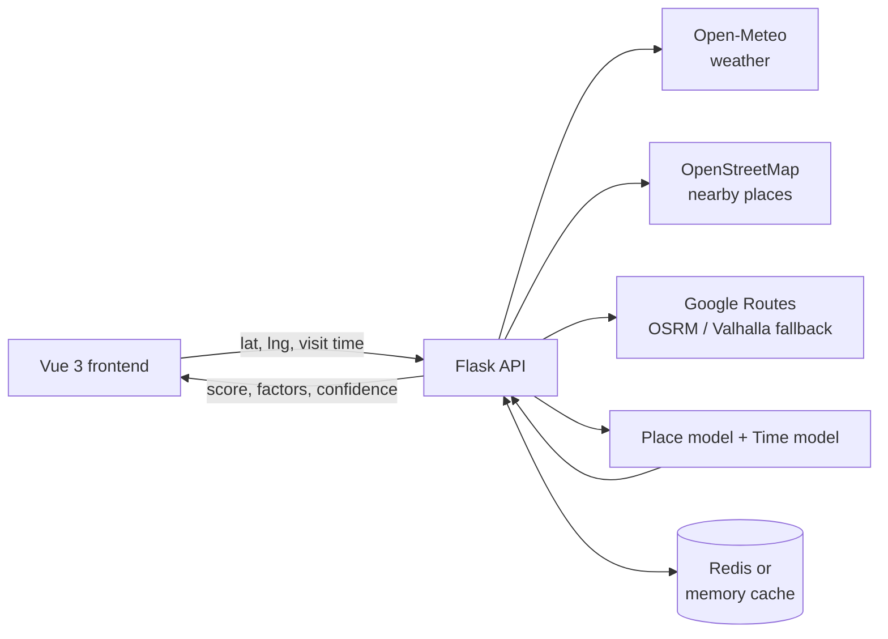

# SafeRoute AI

**Explainable, time-aware safety risk estimates for any place, with route comparison.**

[Live demo](https://ai-tourist-safety-predictor.vercel.app/) | [API contract](API_CONTRACT.md)

SafeRoute AI answers one question for a traveller: **how risky is this place at the time I plan to be there, and is there a safer way to get there?**

Instead of a static "this area is dangerous" warning, it returns a 0-100 risk score for a chosen place and visit time, shows exactly which factors moved the score and by how many points, and states how confident the estimate is. Built by Team Vertex for CodeArambh 2.0 (Travel and Smart Tourism).

## Features

- **Risk score for any location and visit time.** 0-39 Safe, 40-69 Moderate, 70-100 Risky. Higher means riskier.
- **Explainable by design.** Five factor cards (location, time and day, crowd, weather, historical incidents) show their contribution in points, and the cards add up to the score.
- **Honest uncertainty.** Every result carries a confidence label (High, Medium, Low) and a margin in points. Places far from the training region or with unusual surroundings are flagged instead of overstated.
- **Route comparison.** Compares the shortest route with safer alternatives by scoring sampled checkpoints along each route.
- **Live data.** Weather, nearby places and routing are fetched at request time, with caching and graceful fallbacks when a source is unavailable.

## How it works

The score combines two models, each answering a different question:

| Model | Question | Inputs | Algorithm |
|---|---|---|---|
| Place model | Where you are | Counts of nearby bars, shops, food, transit stations, parks, schools and more within 400 m (OpenStreetMap) | XGBoost |
| Time model | When you are there | Hour, weekday, holiday, sun elevation, temperature, rain, snow, wind, cloud cover | XGBoost |

```
score = 50 + place effect (+ local-record effect where available) + time effect + weather effect
```

Every term is in score points, so the factor cards always sum to the final score before clipping to 0-100.



### Training data and results

- **Incidents:** 464,412 Chicago crime records (Oct 2024 - Oct 2026) from the City of Chicago data portal, severity-weighted and aggregated into about 500 m grid cells by hour of week. Placeholder timestamps (exactly 00:00:00 and 12:00:00) are removed.
- **Places:** 40,919 OpenStreetMap places across 12 categories.
- **Scoring scale:** relative to Chicago. A score of 70 means riskier than about 70% of Chicago cell-hours.

| Evaluation | Result |
|---|---|
| Place model, on neighbourhoods never seen in training (spatial cross-validation) | MAE 14.6 points vs 18.2 for guessing the average (about 20% lower); R2 0.29 |
| Time model, on the newest 90 days held out | R2 0.59; beats an hour-of-week average baseline |

Confidence combines distance from the training region, an Isolation Forest outlier check on the surroundings, and whether weather and local records were available.

## Quick start

**Requirements:** Python 3.12, Node.js 18+, optionally Docker for Redis.

```bash
git clone https://github.com/harishgit0/AI-Tourist-Safety-Predictor.git
cd AI-Tourist-Safety-Predictor
```

**Backend**

```bash
python3 -m venv backend/.venv
source backend/.venv/bin/activate          # Windows: backend\.venv\Scripts\activate
pip install -r requirements.txt
cp .env.example .env                       # then add your keys (see below)
python backend/app.py                      # http://localhost:5000
```

**Frontend** (second terminal)

```bash
npm install
npm run dev
```

Set `VITE_API_MODE=live` in the root `.env` to use the Flask API, or `VITE_API_MODE=mock` to run the UI with local mock data. Leave `VITE_API_BASE_URL` empty so Vite proxies to `http://127.0.0.1:5000`.

### Configuration

| Variable | Purpose | Required |
|---|---|---|
| `GOOGLE_MAPS_API_KEY` | Google Routes API for route alternatives. Without it, OSRM and Valhalla are used | Optional |
| `REDIS_URL` | Shared cache, e.g. `redis://localhost:6379/0`. Falls back to in-memory cache | Optional |
| `VITE_API_MODE` | `live` or `mock` | Frontend |
| `VITE_API_BASE_URL` | API origin when not using the Vite proxy | Frontend |

Optional local Redis: `docker compose -f compose.redis.yml up -d`. `GET /api/health` reports whether the cache is `redis` or `memory`.

## API

Full request and response schemas, including error codes, are in [API_CONTRACT.md](API_CONTRACT.md).

| Endpoint | Purpose |
|---|---|
| `POST /api/analyze` | Risk score, factor breakdown and confidence for a place and visit time |
| `GET /api/routes` | Route comparison between an origin and a destination |
| `GET /api/health` | Service status, model metadata and cache backend |

```bash
curl -s -X POST http://localhost:5000/api/analyze \
  -H "Content-Type: application/json" \
  -d '{"name":"Navy Pier","lat":41.8917,"lng":-87.6086,"datetime":"2026-10-24T23:00"}'
```

Example response (trimmed):

```json
{
  "destination": { "name": "Navy Pier", "lat": 41.8917, "lng": -87.6086 },
  "score": 37,
  "level": "Safe",
  "level_range": "0-39",
  "margin_points": 7,
  "confidence": { "label": "Medium", "reasons": ["The surroundings look unusual compared with the places the model learned from."] },
  "factors": [
    { "key": "location", "impact": "neutral", "points": -1.9 },
    { "key": "time", "impact": "lowers", "points": -7.4 },
    { "key": "weather", "impact": "neutral", "points": 0.2 },
    { "key": "history", "impact": "neutral", "points": -3.5 }
  ]
}
```

### Caching

Cache lifetimes follow how fast each source changes: geocoding labels 24 hours; weather forecasts, nearby places, sampled route risk and complete route comparisons 15 minutes. Redis entries hold public map and weather data only; keep the Redis instance private.

## Retraining the models

The trained models ship with the repository. To rebuild them from scratch (needs internet; the OpenStreetMap download takes several minutes and is resumable):

```bash
python backend/ml/download_chicago.py     # Chicago crime records
python backend/ml/build_labels.py         # severity-weighted risk labels per cell and hour
python backend/ml/download_weather.py     # hourly weather history (Open-Meteo)
python backend/ml/build_temporal.py       # hourly dataset for the time model
python backend/ml/train_temporal.py       # time model
python backend/ml/osm_features.py         # nearby-place counts per cell
python backend/ml/train_spatial.py        # place model
```

## Project structure

```
.
├── src/                 Vue 3 + Vite frontend
├── public/              Static assets
├── backend/
│   ├── app.py           Flask entry point
│   ├── services/        Scoring, weather, routing, explanations, cache
│   └── ml/              Data pipeline, training scripts and trained models
├── API_CONTRACT.md      API schemas and error codes
├── compose.redis.yml    Optional local Redis
├── render.yaml          Backend deployment (Render)
└── vercel.json          Frontend deployment (Vercel)
```

## Deployment

The Vue frontend is deployed on Vercel (`vercel.json`) and the Flask API is configured for Render (`render.yaml`). Set the environment variables above in each platform's dashboard. Free-tier backends may take a few seconds to wake up on the first request.

## Limitations and responsible use

- **Trained on Chicago only.** Outside the training region the place and time effects are extrapolations, so confidence is capped at Medium and the UI says so. Retraining on more cities is the main next step.
- **The score is relative and approximate.** The place model explains about 29% of the variation in neighbourhood risk on unseen areas, which is why a margin is always shown.
- **Historical incident records exist only for Chicago.** Elsewhere that factor is shown as unavailable.
- **The holiday signal applies only inside the US,** because it was learned from US federal holidays.
- Estimates are **not verified local safety reports and do not guarantee personal safety.** Do not use them as the sole basis for safety-critical decisions.

## Roadmap

- Add incident data from more cities and evaluate transfer between them
- Replace the crowd estimate with real footfall or event data
- Time-of-day aware route scoring along the full journey
- Mobile-friendly progressive web app

## Data sources and attribution

- Crime data: [City of Chicago Data Portal](https://data.cityofchicago.org/)
- Places and map data: &copy; [OpenStreetMap](https://www.openstreetmap.org/copyright) contributors, available under the ODbL
- Weather: [Open-Meteo](https://open-meteo.com/) (CC BY 4.0)
- Routing: Google Routes API, with OSRM and Valhalla as fallbacks
- Place search: OpenStreetMap Nominatim

## Team

Built by **Team Vertex** for CodeArambh 2.0. Backend, ML and frontend by [Harish Chauhan](https://github.com/harishgit0) and Parvej Khan.

## License

Add a `LICENSE` file (for example MIT) to state how others may use this code.
